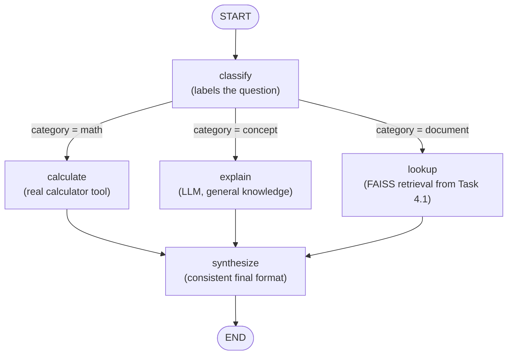

# Task 4.2 - LangGraph Workflow Diagram

## State transitions



## State object

```python
class WorkflowState(TypedDict):
    question: str                  # set at the start, never changes
    category: Optional[str]        # set by classify, read by the conditional edge
    raw_answer: Optional[str]      # set by whichever of calculate/explain/lookup ran
    final_answer: Optional[str]    # set by synthesize, the only output the user sees
```

## Why this design
- **One classify step, three possible paths** - a single router decision keeps the graph easy to follow and
  easy to extend (adding a 4th category only means one more node + one more edge).
- **All three paths converge on `synthesize`** - regardless of which tool/route handled the question, the final
  answer always goes through the same formatting step, so the output is consistent.
- **`calculate` uses a real tool, not the LLM** - LLMs are unreliable at arithmetic; a restricted `eval()` on the
  matched expression is both more accurate and auditable.
- **`lookup` reuses the Task 4.1 FAISS index** - this is intentional: the capstone (4.4) relies on exactly this
  kind of composition, where a workflow step calls into a previously-built retrieval system instead of
  duplicating it.

## What I tested (fill in after running)
*(Run `workflow.py`. For 3-4 questions, note which route it took and whether the routing decision was correct.
Also try one question deliberately on the border between categories, e.g. "Explain how FAISS calculates
similarity using cosine distance" - does it go to `concept` or `document`? Was that the right call?)*

-
