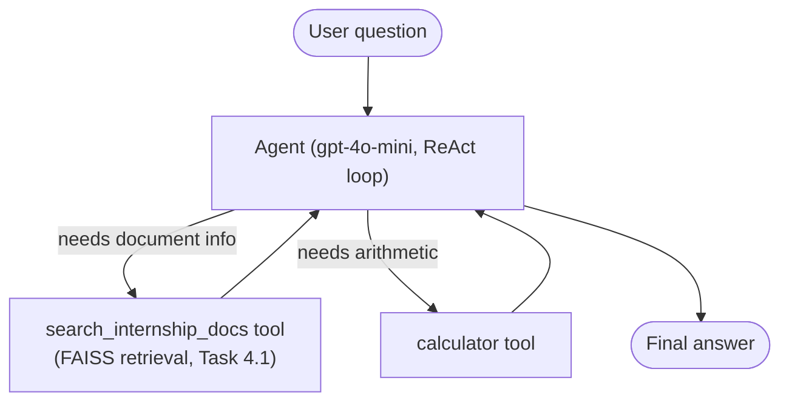

# CAPSTONE: AI Agent System - Report
**Skill Set Go EduTech - AI/ML Internship - Week 4**

## 1. Overview
*(1 paragraph: what does this agent do, in plain language? Who would use it and why?)*

This capstone combines three pieces built earlier in Week 4 into one agent:
- **RAG** (Task 4.1) - a `search_internship_docs` tool backed by a FAISS index over the internship task-format PDF
- **Tool use** (Task 4.2) - a `calculator` tool for real arithmetic instead of LLM guessing
- **Multi-step reasoning** - a ReAct-style agent loop (LangGraph's `create_react_agent`) that can call one tool,
  look at the result, decide to call another tool, and only then produce a final answer

## 2. Architecture

Unlike Task 4.2's fixed router (one classification -> one path), this agent decides tool use dynamically and
can call more than one tool per question - e.g. the "combine both" demo question in `agent.py` calls both
`calculator` and `search_internship_docs` before answering.

## 3. How it was built
*(Briefly describe your process: did you start from the Task 4.1/4.2 code and extend it? What was the
hardest part to get working - tool definitions, memory, routing?)*

-

## 4. Evaluation summary
*(Pull your key findings from Task 4.3's evaluation-report.md - latency, which routes/tools worked reliably,
and the failure cases you found. Don't copy the whole report, just the headline findings relevant to this
capstone.)*

-

## 5. Demo
*(Describe what you showed in your live demo - which questions you asked, what the agent did, and anything
that didn't go as planned live.)*

- Demo link / recording:

## 6. Limitations and future work
*(e.g. no reranking in retrieval, calculator only handles basic arithmetic, no persistent memory across
sessions, single document source.)*

-

## 7. Key learnings
*(3-5 points: what did building and evaluating an actual agent teach you that the individual tasks (4.1-4.3)
didn't?)*

-
